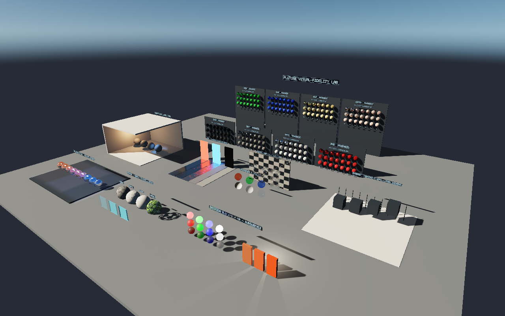

# Visual Fidelity Lab

Open `VisualFidelityLab.plutoproject` in the rebuilt PlutoGE editor. This is a
self-contained engine sample: no CoD assets, scripts, downloads, or third-party
models are required. Its default startup scene is the daylight lab.

Use **View > Viewport Bookmarks** to jump between saved views. The scene also has
named `CAMERA - ...` entities; Overview is the sole main runtime camera. To use
another camera in Play mode, turn off Overview's MainCamera flag and turn on the
desired camera's flag. Editor bookmarks are installed by `python generate.py`;
`ViewportBookmarks.bookmarks` is the portable copy of those views.



## Material and lighting coverage

This is a finite diagnostic set, not every possible value of continuous material
parameters. Entity names and in-world signs identify the samples.

| Zone | Samples | What to inspect |
| --- | --- | --- |
| Material matrices | 8 colours × metallic 0 / 0.5 / 1 × roughness 0.04 / 0.1 / 0.25 / 0.4 / 0.6 / 0.8 / 1: **168 spheres** | Dielectric sky reflections, metallic tint, grazing response, smooth roughness progression. Metallic increases bottom to top; roughness increases left to right. |
| Reflection lane | Five roughness strips, bright red/blue emitters, black target | Move the camera so targets leave the screen. SSR should transition to the environment without double brightness. Black reflections should replace bright fallback lighting. |
| Glass | 3 IORs × 3 roughness values × 2 thicknesses; 3 transmission values; 3 absorption tints | Refraction, thickness, rough reflection/transmission, tint and sorting against a checker backdrop. |
| Local-light studio | Four dielectric roughnesses, warm point, cool shadowed spotlight, enclosing roof/walls | Inverse-square falloff, coloured highlights, spotlight cone, indoor shadow coverage. |
| Shadow bench | Contact/floating boxes and thin fence posts | Contact, bias, detached shadows, page residency and thin caster loss. |
| Probe blend | Nine chrome spheres crossing overlapping warm/cool volumes | Smooth overlap, local fallback and box projection while translating the camera. These are **embedded analytic reference captures**, not a bake of the room geometry. |
| Texture bench | Albedo checker, normal waves, roughness ramp, alpha mask, three blended opacities | Colour-space/channel interpretation, normal detail, filtered roughness and coverage. |
| HDR / subsurface | RGB/white emission at 0.1 / 1 / 10; subsurface 0 / 0.5 / 1 with a backlight | Emission clipping, colour retention, optional bloom and backlit thin surfaces. |

The `Assets/Scenes` folder contains **Daylight**, **Sunset**, **Night** and
**LocalOnly** variants. All share the material layout and named views. LocalOnly
disables the physical sky and directional light; local lights, diagnostic IBL,
emission and signage remain. There is no uniform ambient fill.

## Controlled comparisons

Every camera uses the **Reference** post-process preset: SSR, diffuse AO and fixed
tone mapping. Auto exposure, upscaling, depth of field, motion blur and bloom are
absent so they cannot hide defects. Use the camera's PostProcessPresetAsset field
to compare these supplied presets:

- `Reference`: SSR + AO, fixed exposure.
- `NoSSR`: identical settings with SSR disabled.
- `GI`: adds VCTGI. Allow several frames to settle; ensure the selected graphics
  quality allows GI. Emissive geometry alone does not illuminate neighbours in
  the Reference preset.
- `Presentation`: adds restrained bloom for the HDR/emission bench.

For shadow method comparisons, change the scene's `LIGHTING - ...` directional
light between VSM and Cascaded explicitly. Inspect static frames and movement,
especially viewport resize, screen-edge reflections and newly exposed shadows.
Saved views are starting positions; use the editor fly camera to translate and
inspect the samples at close range. Match view, preset, resolution and lighting
variant when comparing Vulkan/OpenGL or before/after engine builds.

## Regeneration and native captures

`python generate.py` deterministically regenerates the lab's owned scene,
material, texture, metadata, manifest and bookmark files using only Python's
standard library. It overwrites generated assets; keep hand-authored experiments
under different names before regenerating.

Run `python validate.py` to verify asset registration, references, probe payloads,
material-matrix coverage, saved views and one-main-camera ownership in each scene.

From the engine repository root on Windows:

```powershell
cmake --build out/build/msvc18 --config Release --target PlutoGERenderVisualLab
python samples/VisualFidelityLab/capture.py out/build/msvc18/tests/Release/PlutoGERenderVisualLab.exe
python samples/VisualFidelityLab/capture.py out/build/msvc18/tests/Release/PlutoGERenderVisualLab.exe --view "White material closeup" --variant Sunset
```

Captures are written to `Captures/` as PNG and PPM. The native tool loads real
scene assets, checks every mesh/material, uses the normal scene lighting and
post-process translation, and renders sixteen warm-up frames before capture.
It also accepts `<project-root> <scene-file> --validate-only` for asset-loading
checks. Automated captures use Vulkan; compare OpenGL in the editor through
Project Settings > Graphics API.

Capture isolation options: `--no-depth-prepass`, `--no-post-processing` and
`--no-shadows` can be combined with any named view. They affect only the capture
process and do not save changes to the sample assets. For example:

```powershell
python samples/VisualFidelityLab/capture.py out/build/msvc18/tests/Release/PlutoGERenderVisualLab.exe --variant Sunset --view "Texture detail" --no-depth-prepass --no-post-processing --no-shadows --output out/visual-lab-isolated
```
