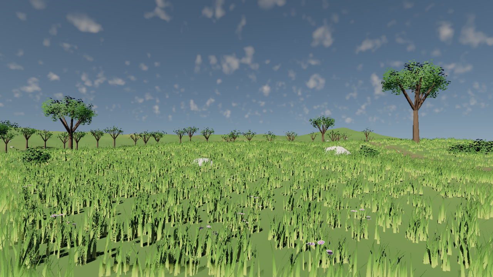

# Wind Fields

A rolling grassland: meadow grass, dry patches, tall grass and wildflowers, with shrubs and broadleaf trees along
the hills. Everything sways in a gusty breeze. The sample shows [foliage wind](../../docs/FOLIAGE_WIND.md), and all of
its art is procedural (`generate.py`), so it needs no downloads.



## Open it

Open `WindFields.plutoproject` in PlutoGEEditor. The wind runs in the editor viewport; press **F5** to see it from
the main camera. Other views are the cameras named `CAMERA - ...`.

## What to look at

| Entity | What it shows |
| --- | --- |
| **Wind** | The scene's `WindComponent`. Change **Speed**, **Direction**, **Gustiness** and **Gust Size**, and watch gust fronts roll across the meadow. Disable it and everything stops. |
| **Vegetation: Grass** | Six types: meadow and dry grass (one mesh, two materials), tall grass and three wildflower colours. Each type has a **Wind** section; grass uses the Grass preset (soft, high flutter) and flowers use slightly stiffer stems. |
| **Vegetation: Trees** | A trunk type and a crown type, with the same placements and the same Tree response, so they bend together. The trunk is anchored below its pivot height. Trunks have capsule collision. |
| **Vegetation: Shrubs** | The Shrub preset: moderate sway and leafy flutter. |
| **Vegetation: Rocks** | A type without wind. Rocks stay still beside the swaying plants. |
| **Sky** | A physical sky, and clouds drifting with the wind. |

Ground cover casts no shadow-map shadows; contact shadows ground it. A swaying caster redraws its shadow pages
every frame, and 70,000 grass clumps would dominate the shadow budget on integrated GPUs. Trees and shrubs keep
their shadow-map shadows, which sway with them.

## Regenerate

```text
python samples/WindFields/generate.py
```

The script is deterministic and writes only below this folder:

- the meshes (`.glb`), textures, materials and post-process preset;
- the terrain (257 × 257 heights, inline);
- the scene, with about 79,000 foliage instances placed by jittered grids and noise masks.

Edit the constants at the top (`WIND`, the terrain size) or the scatter densities in `build_scene` and re-run.

## Capture

```text
python samples/WindFields/capture.py             # one still per view
python samples/WindFields/capture.py --motion    # plus an animated GIF and a motion difference image per view
```

`capture.py` drives `PlutoGERenderSceneShot`. Its `--time` option poses the wind at a fixed shader-clock time, so
successive frames show the sway. In the difference image, everything that moved is bright: grass, flowers, shrubs
and crowns move, while the ground, rocks and trunk bases do not.
